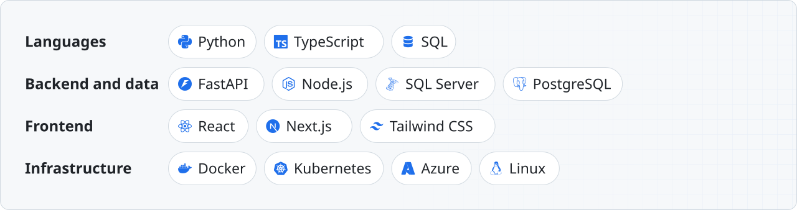

<picture>
  <source media="(max-width: 600px) and (prefers-color-scheme: dark)" srcset="assets/banner-narrow-dark.svg">
  <source media="(max-width: 600px)" srcset="assets/banner-narrow-light.svg">
  <source media="(prefers-color-scheme: dark)" srcset="assets/banner-dark.svg">
  
</picture>

  
  
  
  

I build the internal software that runs day-to-day operations at **Drewlo Holdings**, a property management and construction company. My work spans self-hosted AI, internal platforms, and the data and automation behind the business. Most of it lives in private repositories.

## What I work on

<picture>
  <source media="(max-width: 600px) and (prefers-color-scheme: dark)" srcset="assets/cards-narrow-dark.svg">
  <source media="(max-width: 600px)" srcset="assets/cards-narrow-light.svg">
  <source media="(prefers-color-scheme: dark)" srcset="assets/cards-dark.svg">
  
</picture>

## How I work

- **Data stays in-house.** If a system can run on our own hardware, it does.
- **Missing data is reported, not guessed.** When the answer isn't in the data, the software says so.
- **Failures are loud.** A broken dependency raises an error instead of falling back silently.

## Stack

<picture>
  <source media="(max-width: 600px) and (prefers-color-scheme: dark)" srcset="assets/stack-narrow-dark.svg">
  <source media="(max-width: 600px)" srcset="assets/stack-narrow-light.svg">
  <source media="(prefers-color-scheme: dark)" srcset="assets/stack-dark.svg">
  
</picture>
